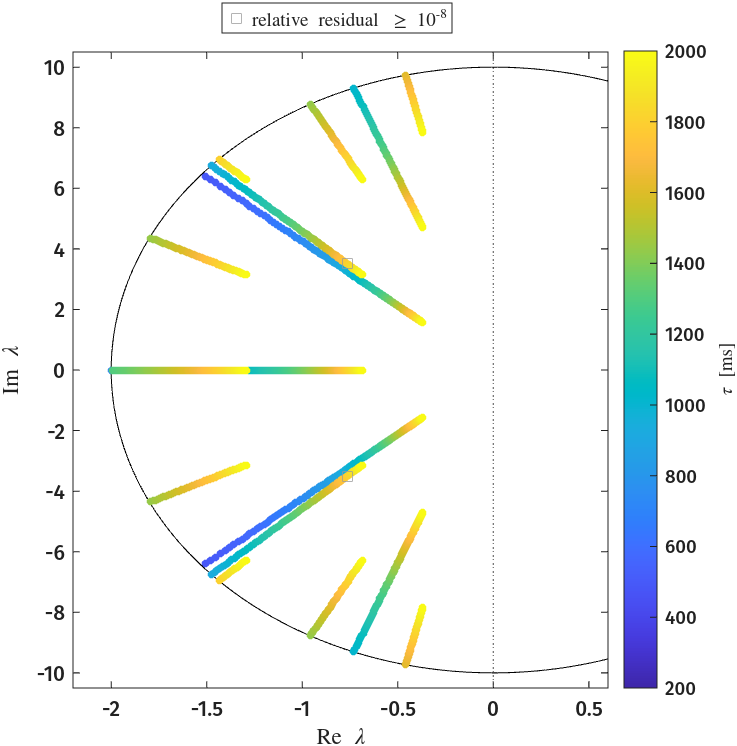
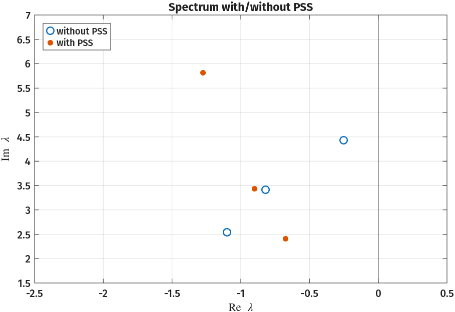
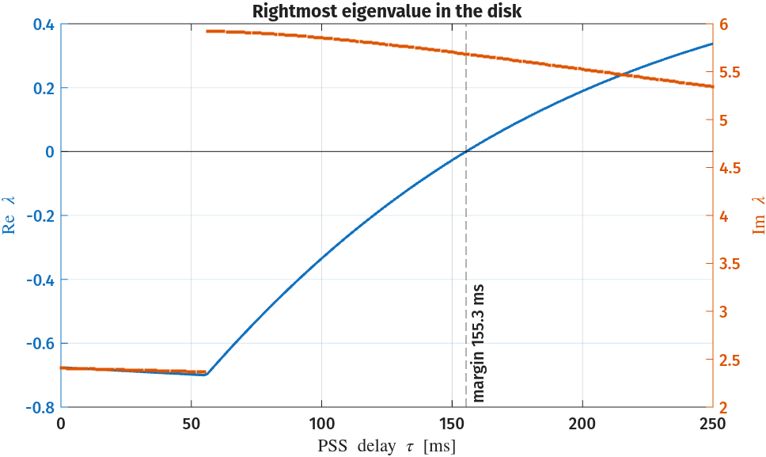
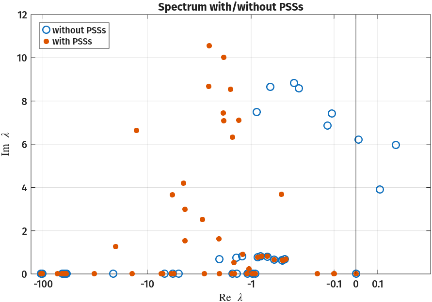
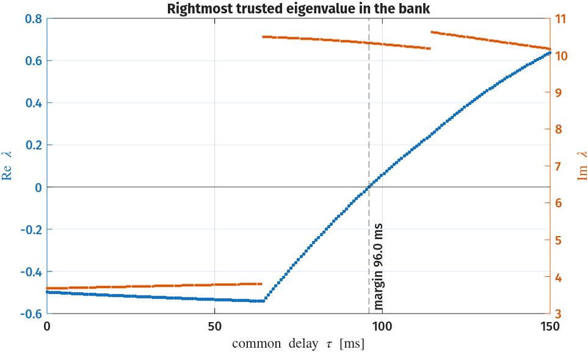
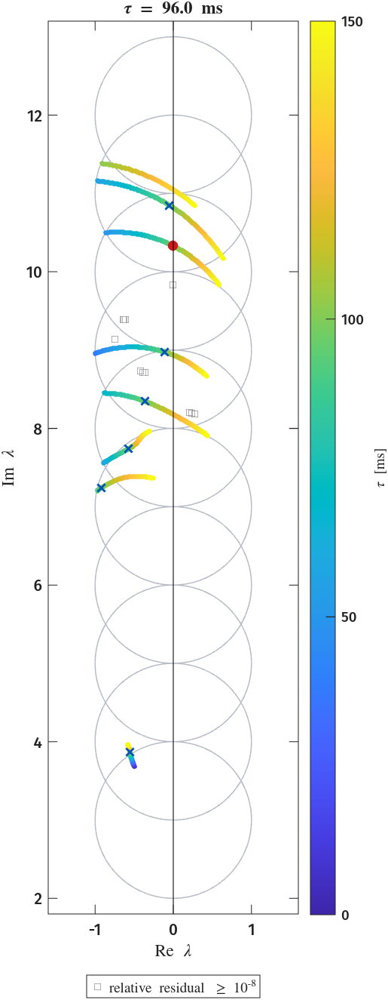
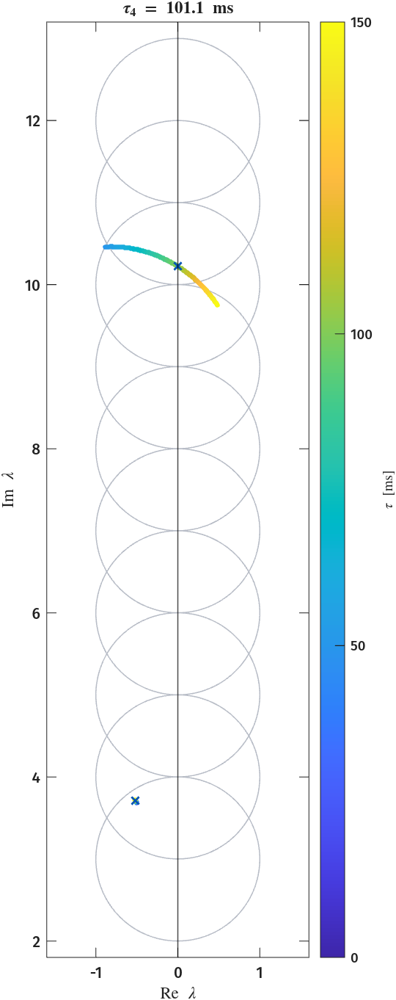

# Time-Delay Eigenvalue Problems

Many physical systems carry a _time delay_ \( \tau \): a signal, a wave, or a
measurement arrives some time after it is produced.
When systems incorporate a delay, it is often of interest to determine for which delay the system becomes unstable i.e. to determine the _stability margin_ of the system.
For continuous-time systems, this is given by the smallest \( \tau \) such that poles of the system have zero real part.
A general delay system can be written in the following form

\[
\mathbf{E}\dot{x}(t) = \varphi\big(t, x(t), x(\kappa(t)), \dot{x}(\kappa(t))\big),
\qquad
\kappa_i(t) = t - \tau_i, \quad i = 1, 2, \dots, k_m .
\]

where \( \tau = \left[ \tau_1, \ldots, \tau_{k_m} \right]^\top \in \mathbb{R}^{k_m} \) is a set of constant delays.
When \( \phi \) depends only on the first three arguments, we say that that the system is _retarded_ and, otherwise, we say that it is _neutral_.
Below are two examples of such systems with only a single delay

\[
\underbrace{\mathbf{E}\dot{x}(t) = \mathbf{A}_0 x(t) + \mathbf{A}_1 x(t-\tau)}_{\text{retarded}}
\qquad
\underbrace{\mathbf{E}_0\dot{x}(t) + \mathbf{E}_1\dot{x}(t-\tau) = \mathbf{A}_0 x(t) + \mathbf{A}_1 x(t-\tau)}_{\text{neutral}} .
\]

Seeking solutions of the form \( x(t) = e^{\lambda t}\vec{v} \) turns the stability question for these systems into a *nonlinear*
eigenvalue problem \( \mathbf{T}(\lambda, \tau)\,\vec{v} = 0 \).
After some algebraic manipulations, the above equations become

\[
\underbrace{\mathbf{T}(\lambda,\tau) = \lambda\mathbf{I} - \mathbf{A}_0 - \mathbf{A}_1 e^{-\lambda\tau}}_{\text{retarded}}
\qquad
\underbrace{\mathbf{T}(\lambda,\tau) = \lambda(\mathbf{I} + \mathbf{E}_1 e^{-\lambda\tau}) - \mathbf{A}_0 - \mathbf{A}_1 e^{-\lambda\tau}}_{\text{neutral}} .
\]

Unlike polynomial or rational eigenvalue problems, these are transcendental in \( \lambda \); there are infinitely many eigenvalues, and no exact, finite linearisation exists.
On any bounded region of the complex plane, however, there exist only
finitely many eigenvalues, and we can use CIMs to recover eigenpairs in a domain of interest.
All three examples below use the same multi-point Loewner mode.
The realisation size \( m \) sits at the largest gap in the singular values of the Loewner matrix \( \mathbb{D} \) (even when the gap is smaller than \( 10^3 \)).
A contour whose sample moments are at noise level, below `options.EmptyTol` \( = 10^{-10} \) relative to their bound, is read as empty, with \( m = 0 \).
Eigenvalues with relative residual \( \lVert \mathbf{T}(\lambda)\mathbf{v} \rVert_2 / \lVert \mathbf{T}(\lambda) \rVert_F \geq 10^{-8} \) are drawn as empty grey boxes.

---

## 1. A partial element equivalent circuit[^1]

A partial element equivalent circuit (PEEC) models a three dimensional circuit interconnect with propagation delay; they are written as delay differential equations.
Time-domain solvers are less robust for these equations than for ordinary circuits, so it matters when the model itself is stable[^2].
To this end we consider a test circuit of Bellen, Guglielmi and Ruehli[^2] given by the _neutral_ delay differential equation

\[
\dot{x}(t) = \mathbf{L}\, x(t) + \mathbf{M}\, x(t-\tau) + \mathbf{N}\, \dot{x}(t-\tau), \qquad x(t) \in \mathbb{R}^{3},
\]

where the matrices are

\[
\frac{\mathbf{L}}{100} = \begin{pmatrix} -7 & 1 & 2 \\ 3 & -9 & 0 \\ 1 & 2 & -6 \end{pmatrix}
\quad
\frac{\mathbf{M}}{100} = \begin{pmatrix} 1 & 0 & -3 \\ -0.5 & -0.5 & -1 \\ -0.5 & -1.5 & 0 \end{pmatrix}
\quad
\mathbf{N} = \frac{1}{72}\begin{pmatrix} -1 & 5 & 2 \\ 4 & 0 & 3 \\ -2 & 4 & 1 \end{pmatrix},
\]

Our problem of interest is given as

\[ \mathbf{T}(\lambda) = \lambda(\mathbf{I} - \mathbf{N}e^{-\lambda\tau}) - \mathbf{L} - \mathbf{M}e^{-\lambda\tau}. \]

We can track the eigenvalues of the delay problem as \( \tau \) increases inside, say, an ellipse centred at the origin.

??? note "Code (the ellipse CIM and the delay sweep)"
    ``` matlab
    --8<-- "src/demos/peec/milano_peec_1.m:setup"

    --8<-- "src/demos/peec/milano_peec_1.m:sweep"
    ```



??? note "Plotting code (tau_sweep.png)"
    The sweep script `src/demos/peec/milano_peec_1.m` writes `ews` and their relative residuals `rr` to `peec_tau_sweep.csv`, which this script reads.

    ``` matlab
    --8<-- "src/demos/peec/peec_figures.m:plot"
    ```

As \( \tau \) grows, eigenvalues enter the ellipse and move toward the imaginary axis.
The ellipse holds none at \( \tau = 200 \) ms and 16 at \( \tau = 2000 \) ms.
Note that none appear to cross the imaginary axis, and, in fact, this holds for all \( \tau \).

The eigenvalues of \( \mathbf{L} \) are \( -407.9 \) and \( -896 \pm 78i \), so \( \lambda\mathbf{I} - \mathbf{L} \) is invertible for \( \operatorname{Re} \lambda \ge 0 \), and there we can factor

\[ \mathbf{T}(\lambda) = (\lambda\mathbf{I} - \mathbf{L})\big(\mathbf{I} - e^{-\lambda\tau}\mathbf{F}(\lambda)\big), \qquad \mathbf{F}(\lambda) = (\lambda\mathbf{I} - \mathbf{L})^{-1}(\lambda\mathbf{N} + \mathbf{M}). \]

The only poles of \( \mathbf{F} \) are the eigenvalues of \( \mathbf{L} \), so \( \mathbf{F} \) is analytic on the closed right half-plane.
Further, writing \( \lambda\mathbf{N} = (\lambda\mathbf{I} - \mathbf{L})\mathbf{N} + \mathbf{L}\mathbf{N} \) gives \( \mathbf{F}(\lambda) = \mathbf{N} + (\lambda\mathbf{I} - \mathbf{L})^{-1}(\mathbf{M} + \mathbf{L}\mathbf{N}) \), a stable proper transfer function with \( \mathbf{F}(\lambda) \to \mathbf{N} \) as \( |\lambda| \to \infty \).
Its \( \mathcal{H}_\infty \) norm

\[ \|\mathbf{F}\|_{\infty} = \sup_{\operatorname{Re} \lambda \ge 0} \|\mathbf{F}(\lambda)\|_2 = \sup_{\omega \in \mathbb{R}} \|\mathbf{F}(i\omega)\|_2 \]

is finite, and MATLAB computes it from a state-space realisation.

??? note "Code (the small-gain bound)"
    ``` matlab
    --8<-- "src/demos/peec/milano_peec_1.m:hinf"
    ```

For \( \operatorname{Re} \lambda \ge 0 \) we have \( |e^{-\lambda\tau}| \le 1 \), so \( \|e^{-\lambda\tau}\mathbf{F}(\lambda)\|_2 \le 0.6633 < 1 \).
Hence, \( \mathbf{I} - e^{-\lambda\tau}\mathbf{F}(\lambda) \Rightarrow \mathbf{T}(\lambda) \) are nonsingular for every \( \tau \ge 0 \).

!!! note
    `ss` and `hinfnorm` require the Control System Toolbox.
    The rest of this example runs in base MATLAB.

The full demo is `src/demos/peec/milano_peec_1.m`.

---

## 2. A three-bus system with a delayed stabiliser[^3]

Wide-area controllers act on remote measurements, so their inputs arrive
delayed. Milano's three-bus system[^3] is a two-machine network whose
electromechanical oscillation is damped by a *power system stabiliser* (PSS);
the PSS input is the rotor speed of machine 1, measured with delay \( \tau \).
The small-signal model is given as

\[
\dot{x}(t) = \mathbf{A}_0 x(t) + \mathbf{A}_1 x(t - \tau)
\]

This is a _retarded_ delay differential equation
\( \mathbf{T}(\lambda,\tau)=\lambda\mathbf{I}-\mathbf{A}_0-\mathbf{A}_1 e^{-\lambda\tau} \),
with \( \mathbf{A}_0 \) the state matrix of the machines, the automatic voltage regulators (AVRs) and the PSS, and the sparse \( \mathbf{A}_1 \) the delayed speed input of the PSS.

??? note "Code (\( \mathbf{A}_0 \), \( \mathbf{A}_1 \) and \( \mathbf{T} \) on 23 states)"
    ``` matlab
    --8<-- "src/demos/3bus/milano_3bus_ex11_1.m:setup"
    ```

One MPLoewner CIM on the circle \( |z - (-0.5 + 4i)| = 2.6 \), with \( K = 50 \) and \( \ell = r = 5 \) fixed probing directions, is reused at 201 delays from 0 to 250 ms.

??? note "Code (the CIM, the delay sweep and the margin)"
    ``` matlab
    --8<-- "src/demos/3bus/milano_3bus_sweep.m:cim"

    --8<-- "src/demos/3bus/milano_3bus_sweep.m:sweep"

    --8<-- "src/demos/3bus/milano_3bus_sweep.m:disk_eigs"
    ```

Three eigenvalues are recovered inside the contour at every delay, with relative residuals at most \( 7.5\times10^{-19} \).
At \( \tau = 50 \) ms they include the delay-critical electromechanical mode near \( -0.75 \pm 5.92i \).
Sweeping \( \tau \) drives it across the imaginary axis at the delay margin of 155.3 ms, where it crosses at \( \pm 5.684i \).

Spectrum with and without the PSS | Delay-induced instability
:-----------------------------:|:-----------------------------:
 | 

The left plot shows the critical portion of the spectrum with and without the PSS.
The right plot shows the rightmost eigenvalue in the disk against \( \tau \).
The model is built by `src/demos/3bus/milano_3bus_ex11_1.m`.
`milano_3bus_spectra.m` and `milano_3bus_sweep.m` in the same folder compute the data, and `milano_3bus_figures.m` draws both figures from their CSVs.

??? note "Plotting code (spectra.png, delay_margin.png)"
    ``` matlab
    --8<-- "src/demos/3bus/milano_3bus_fig_spectra.m:plot"
    ```

    ``` matlab
    --8<-- "src/demos/3bus/milano_3bus_fig_margin.m:plot"
    ```

---

## 3. Ten Delayed PSSs on a 39-bus power network[^7]

The IEEE PES benchmark version of the New England 39-bus network[^6] is a published model with ten generators, each with a PSS[^7][^8].
It is given as a differential algebraic equation (DAE)

\[ \dot{x} = f(x,y) \quad | \quad 0 = g(x, y) \]

where \(f\) contains the variables related to generator state, inertia, automatic voltage regulators (AVRs), PSSs, loads, and transmission lines.
From the provided `Ared.mat`, we are given \( A_\text{red} = f_x - f_y g_y^{-1} g_x \), a structured sparse matrix that corresponds to the state of an autonomous LTI system that describes the linearized and reduced DAE.
From the state layout of the report's Table 11, we can identify the PSS components explicitly.
Without the PSSs the network is unstable, with rightmost eigenvalue \( +0.20 + 5.97i \);
with them it is stable, and the rightmost of its oscillatory modes is \( -0.50 + 3.68i \).



??? note "Plotting code (pes39_spectra.png)"
    `pes39_spectra.m` writes `spectra.csv`, which this script reads.

    ``` matlab
    --8<-- "src/demos/pes39/pes39_fig_spectra.m:plot"
    ```

To each identified PSS, we apply a delay, yielding the following _retarded_ problem with ten delays

\[ \mathbf{T}(\lambda, \tau) = \lambda\mathbf{I} - \mathbf{A}_0 - \sum_{k=1}^{10} \mathbf{b}_k \mathbf{e}_k^\top e^{-\lambda\tau_k} = \lambda\mathbf{I} - \mathbf{A}_0 - \mathbf{B}\operatorname{diag}\big(e^{-\lambda\tau_1}, \dots, e^{-\lambda\tau_{10}}\big)\mathbf{E}^\top, \]

where \( \mathbf{e}_k \) selects the speed of the \( k \)th generator and \( \mathbf{b}_k \) holds \( x_W, x_P, x_Q, E_{fd}, \) and \( x_i \).
See the report[^7] for more details.

??? note "Code (\( \mathbf{T}(\lambda, \tau) \) from \( \mathbf{A}_0 \), \( \mathbf{B} \) and \( \mathbf{E} \))"
    ``` matlab
    --8<-- "src/demos/pes39/pes39_model.m:model"
    ```

First, we track the rightmost eigenvalue as the common delay \( \tau = \tau_k \) grows, with ten overlapping disks of radius \( \rho = 1 \) centred at \( 3i, 4i, \dots, 12i \).
Each disk is an independent CIM computation, so the disks can run in parallel[^5].
A disk returns every eigenvalue it finds inside its contour, and an eigenvalue found by two disks is kept only once via the smaller residual.
In the common-delay and single-loop sweeps below, the trusted residuals are at most \( 9.8\times10^{-11} \) in the common-delay sweep.

??? note "Code (the disk bank and the trust rule)"
    ``` matlab
    --8<-- "src/demos/pes39/pes39_bank.m:bank"

    --8<-- "src/demos/pes39/pes39_bank.m:trust"
    ```

??? note "Code (the delay margin)"
    ``` matlab
    --8<-- "src/demos/pes39/pes39_margin.m:margin"

    --8<-- "src/demos/pes39/pes39_margin.m:abscissa"
    ```

??? note "Code (the common-delay sweep)"
    ``` matlab
    --8<-- "src/demos/pes39/pes39_sweep.m:sweep"
    ```

We find that the stability margin of the entire system is \( \sim 96 \) ms.
The rightmost eigenvalue switches from \( 3.81i \) to \( 10.49i \) between 63.75 and 64.50 ms, and again, from \( 10.18i \) to \( 10.62i \), at about 114 ms.
The left CIM bank figure below shows trajectories as the common delay grows from \( 0 - 150 \) ms.

Next, we examine the effect of a delay on a single PSS, as if it had a sudden drop in a speed signal;
we take \( \tau = \tau_k \mathbf{e}_k \) for \( k = 1, \ldots, 10 \), while the other nine act without delay.
The table below shows the delayed PSS, its rightmost eigenvalue at the stability margin, and the corresponding delay.
Note that the PSS on generators 1 and 10 with individual delays did not make the system unstable up to a delay of 500 ms.
The right CIM bank figure shows the eigenvalue trajectory associated with the delay associated with the worst case, generator 4.

<div style="display: flex; flex-wrap: wrap; gap: 1.5rem; align-items: center;" markdown>
<div style="flex: 3 1 22rem; text-align: center;" markdown>

Rightmost \( \operatorname{Re}\lambda \) against the common delay



</div>
<div style="flex: 2 1 16rem; text-align: center;" markdown>

Delay margin with a single delayed PSS

| Generator | Rightmost eigenvalue at the margin | Delay margin [ms] |
|:---:|:---:|:---:|
| 1 | --- | --- |
| 2 | \( 7.675i \) | 178.32 |
| 3 | \( 8.845i \) | 114.35 |
| 4 | \( 10.222i \) | 101.06 |
| 5 | \( 7.001i \) | 250.56 |
| 6 | \( 8.673i \) | 252.49 |
| 7 | \( 10.552i \) | 157.11 |
| 8 | \( 10.828i \) | 101.30 |
| 9 | \( 8.257i \) | 114.33 |
| 10 | --- | --- |

</div>
</div>

The disk bank as the common delay grows | The disk bank as \( \tau_4 \) grows
:-------------------------------:|:-------------------------------:
 | 

The model is built by `src/demos/pes39/pes39_model.m`.
In the same folder, `pes39_spectra.m`, `pes39_common_margin.m`, `pes39_single_margin.m`, `pes39_sweep.m` and `pes39_single_sweep.m` compute the data, and `pes39_figures.m` draws the four figures from their CSVs.

[^1]: D. Yue and Q.-L. Han, "A Delay-Dependent Stability Criterion of Neutral Systems and its Application to a Partial Element Equivalent Circuit Model," IEEE Transactions on Circuits and Systems II: Express Briefs, vol. 51, no. 12, pp. 685-689, 2004, doi: 10.1109/TCSII.2004.837286.
[^2]: A. Bellen, N. Guglielmi, and A. E. Ruehli, "Methods for Linear Systems of Circuit Delay Differential Equations of Neutral Type," IEEE Transactions on Circuits and Systems I: Fundamental Theory and Applications, vol. 46, no. 1, pp. 212-216, 1999.
[^3]: Milano, Dassios, Liu, and, Tzounas, *Eigenvalue Problems in Power Systems*. Boca Raton, FL: CRC Press, 2020. The three-bus system is defined in Appendix A, A_S is given in Appendix B; the delayed-PSS study is Example 11.1, and the PSS design is Example 4.3.
[^5]: S. Gao, Z. Du, and Y. Li, "Estimating Number of Critical Eigenvalues of Large-Scale Power System Based on Contour Integral," IEEE Transactions on Power Systems, vol. 36, no. 6, pp. 5854-5862, 2021, doi: 10.1109/TPWRS.2021.3084683.
[^6]: T. Athay, R. Podmore, and S. Virmani, "A Practical Method for the Direct Analysis of Transient Stability," IEEE Transactions on Power Apparatus and Systems, vol. PAS-98, no. 2, pp. 573-584, 1979 (the New England 39-bus system).
[^7]: I. Hiskens, "IEEE PES Task Force on Benchmark Systems for Stability Controls: Report on the 39-bus system (New England reduced model)," working paper, 2013, https://cmte.ieee.org/pes-psdp/benchmark-systems-2/.
[^8]: C. Cañizares, T. Fernandes, E. Geraldi Jr., L. Gérin-Lajoie, M. Gibbard, I. Hiskens, et al., "Benchmark Models for the Analysis and Control of Small-Signal Oscillatory Dynamics in Power Systems," IEEE Transactions on Power Systems, vol. 32, no. 1, pp. 715-722, 2017, doi: 10.1109/TPWRS.2016.2561263.
