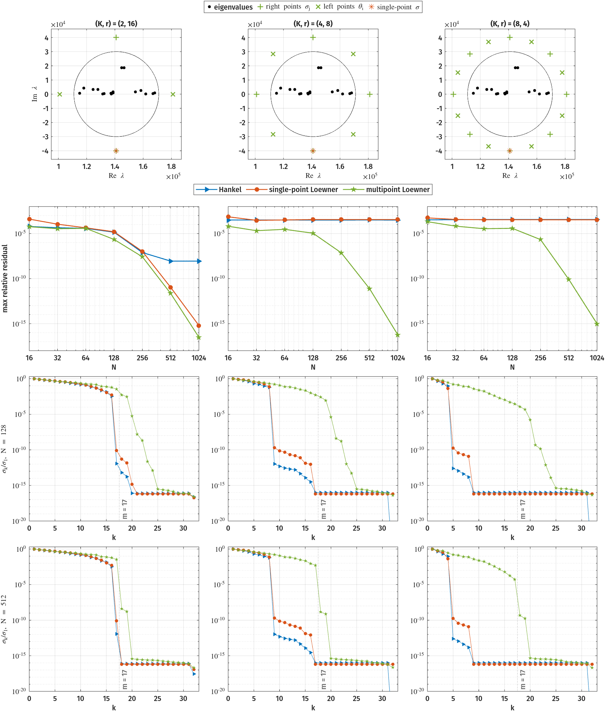

# The Gun Problem: a Large and Sparse Benchmark

The _gun problem_[^1] models the resonances of a radio-frequency gun cavity
and is a standard large-scale benchmark of the nonlinear-eigenvalue
literature. We consider the operator given as

\[
\mathbf{T}(\lambda) \;=\; \mathbf{K} \;-\; \lambda\mathbf{M}
\;+\; i\sqrt{\lambda}\,\mathbf{E}_1
\;+\; i\sqrt{\lambda-\sigma_2^2}\,\mathbf{E}_2,
\qquad \sigma_2 = 108.8774,
\]

with all four coefficient matrices sparse \( 9956\times9956 \) matrices from a
finite-element discretisation. The square roots make the problem
genuinely nonlinear.
Due to the problem size, a dense sampler would be prohibitively expensive, so, in CIMTOOL, we take advantage of the sparsity of \( \mathbf{T}(z) \) where possible.
Additional computation efficiencies can be derived if more structure is known about the underlying operator.

Brennan, Embree and Gugercin[^4] compare the Hankel, single-point Loewner and multipoint Loewner methods, on the disk \( |\lambda - 141000| < 30000 \), which holds \( m = 17 \) eigenvalues;
we repeat a similar experiment with CIMTOOL, opting to use separate left and right shift sets.

Each method realizes 17 eigenvalues from \( 32\times32 \) data matrices, built from \( K \) moments or interpolation points and \( \ell = r \) probing directions such that \( K \ell = 32 \).
The single-point Loewner shift is \( \sigma = 141000 - 40000i \), directly below the contour.
Multipoint Loewner places \( K \) right points \( \sigma_j \) on the concentric circle of radius 40000, starting at \( 141000 + 40000i \), and \( K \) left points \( \theta_i \) midway between them, so that the shift sets are interleaved.

When switching computational modes and \( K/m \) parameters, we do not need to resample \( T^{-1} \); all three methods use the same sample set.
The demo samples \( \mathbf{T}(z)^{-1}\mathbf{R} \) and \( \mathbf{L}^*\mathbf{T}(z)^{-1} \) for 16 directions on nested trapezoid rules with \( N = 16, 32, \ldots, 1024 \).
Each case then utilizes only the leading \( \ell \) directions to realize \( H \).

We compute the maximum relative residual \( \max_j \lVert \mathbf{T}(\lambda_j)\mathbf{v}_j\rVert_2 / \lVert \mathbf{T}(\lambda_j)\rVert_F \) over the 17 computed eigenpairs.
The figure below shows how different numbers of moments/probing can affect performance of the three modes.

| \( (K, r) \) | Hankel | single-point Loewner | multipoint Loewner |
|:---:|:---:|:---:|:---:|
| \( (2, 16) \) | \( 8.7\times10^{-9} \) | \( 6.2\times10^{-16} \) | \( 3.1\times10^{-17} \) |
| \( (4, 8) \) | \( 3.2\times10^{-4} \) | \( 3.6\times10^{-4} \) | \( 5.7\times10^{-17} \) |
| \( (8, 4) \) | \( 3.6\times10^{-4} \) | \( 3.4\times10^{-4} \) | \( 9.6\times10^{-16} \) |

The figure shows the contour and shift placement, as well as maximum relative residuals and the singular value decay of the three modes for each of the three cases we consider.
The table gives the residuals of the three modes at \( N = 1024 \).
With 16 directions both SP/MPLoewner converge to machine precision, while Hankel stalls at \( \sim 10^{-8} \).
With 4 or 8 directions, Hankel and SPLoewner stall at \( \sim 3\times10^{-4} \) for every \( N >= 64 \), and MPLoewner still converges.

The demo is `src/demos/gun/gun_nlevp.m`, and `src/demos/gun/gun_figures.m` draws the figure from its CSVs.
The [NLEVP collection](https://github.com/ftisseur/nlevp) is required to be on the MATLAB path.

[^1]: T. Betcke, N. J. Higham, V. Mehrmann, C. Schröder, and F. Tisseur, "NLEVP: A Collection of Nonlinear Eigenvalue Problems," ACM Transactions on Mathematical Software, vol. 39, no. 2, 2013, doi: 10.1145/2427023.2427024. The gun problem originates in B.-S. Liao, Z. Bai, L.-Q. Lee, and K. Ko, "Nonlinear Rayleigh-Ritz iterative method for solving large scale nonlinear eigenvalue problems," Taiwanese Journal of Mathematics, vol. 14, no. 3A, pp. 869-883, 2010.
[^4]: M. C. Brennan, M. Embree, and S. Gugercin, "Contour Integral Methods for Nonlinear Eigenvalue Problems: A Systems Theoretic Approach," SIAM Review, vol. 65, no. 2, pp. 439-470, 2023, doi: 10.1137/20M1389303. -- (Fig. 7, Sec. 5.4)
