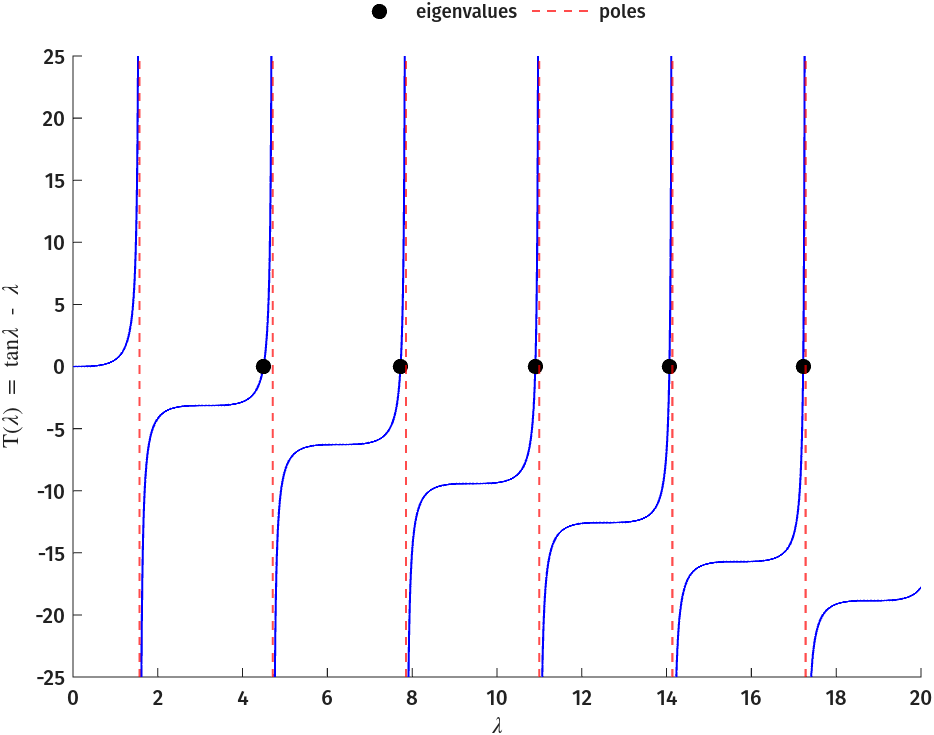
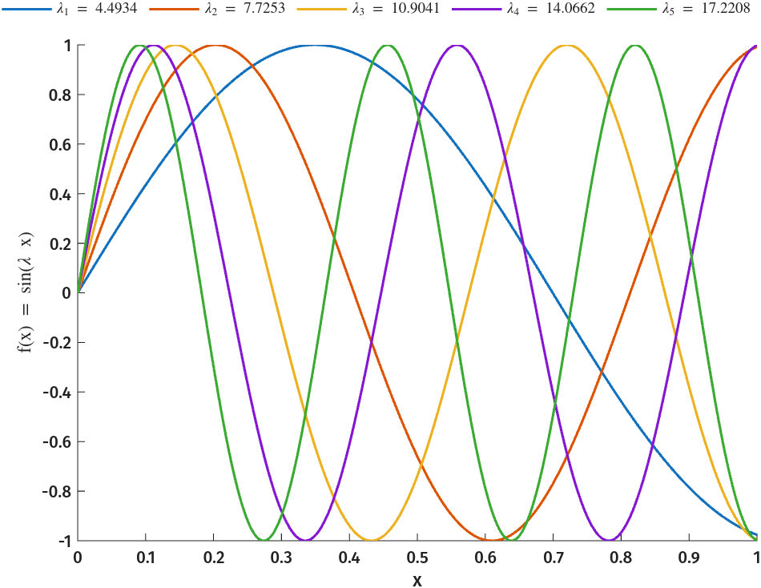
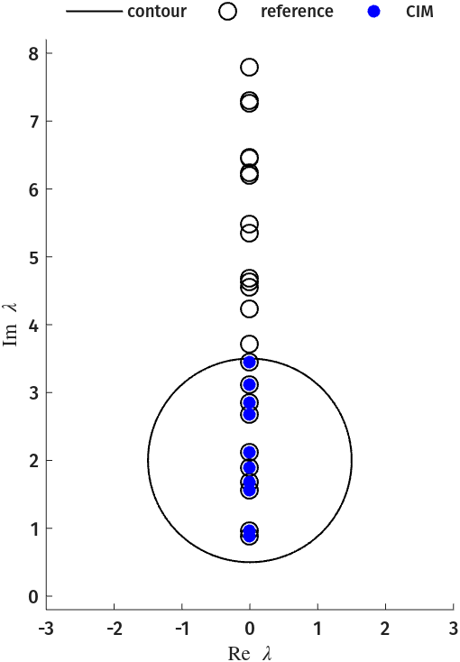
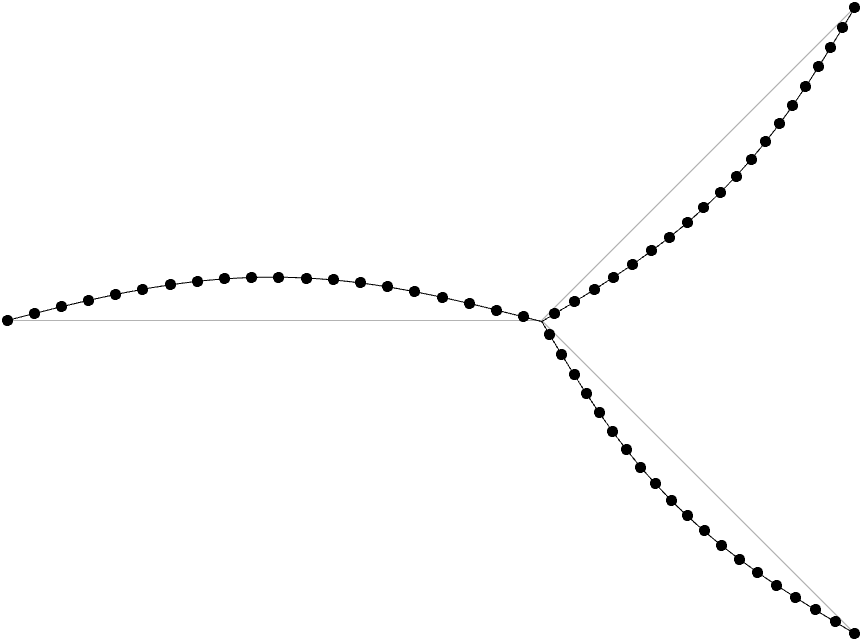
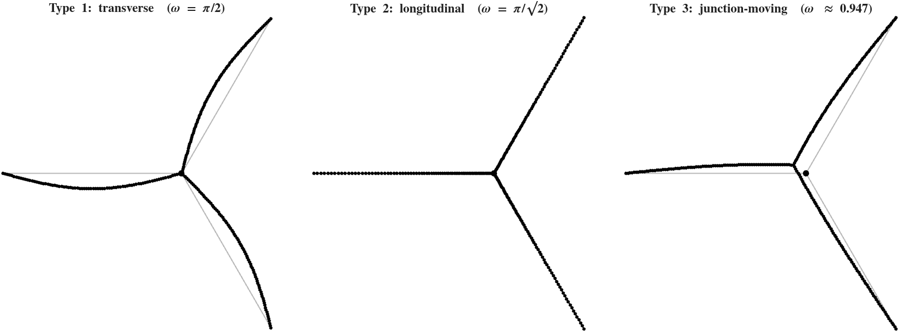
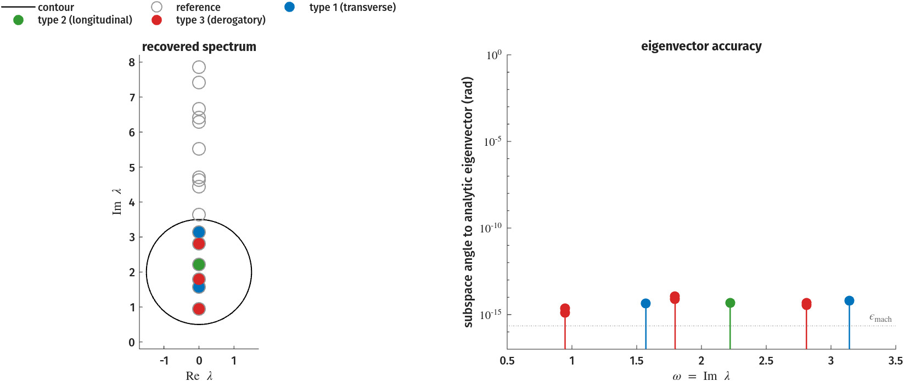
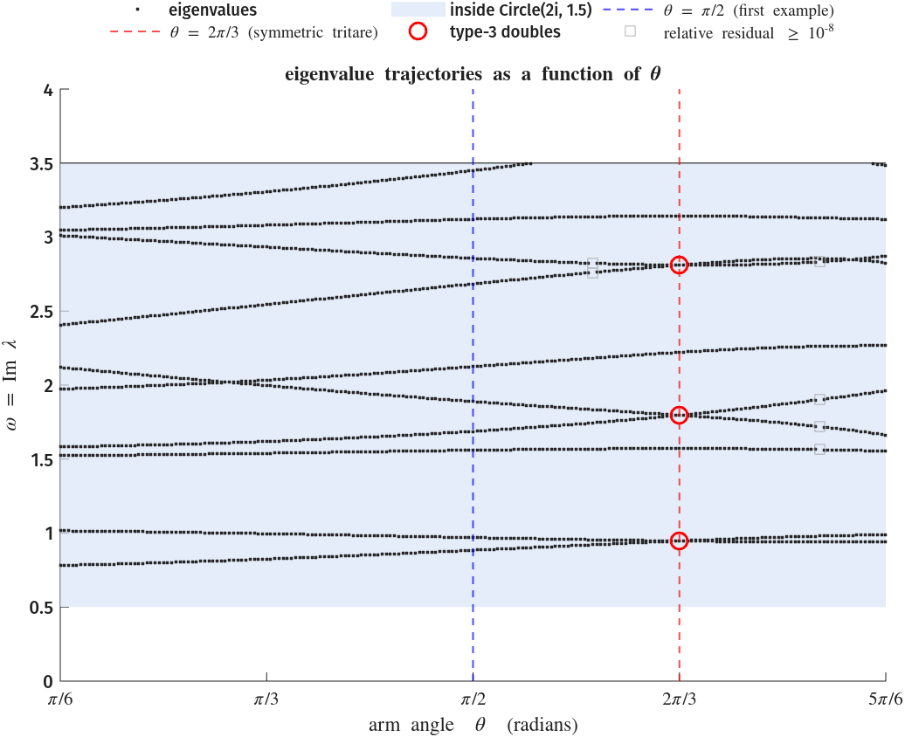
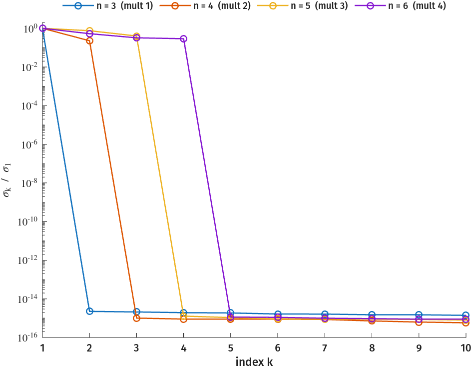
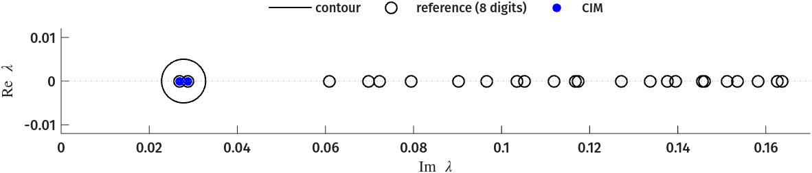
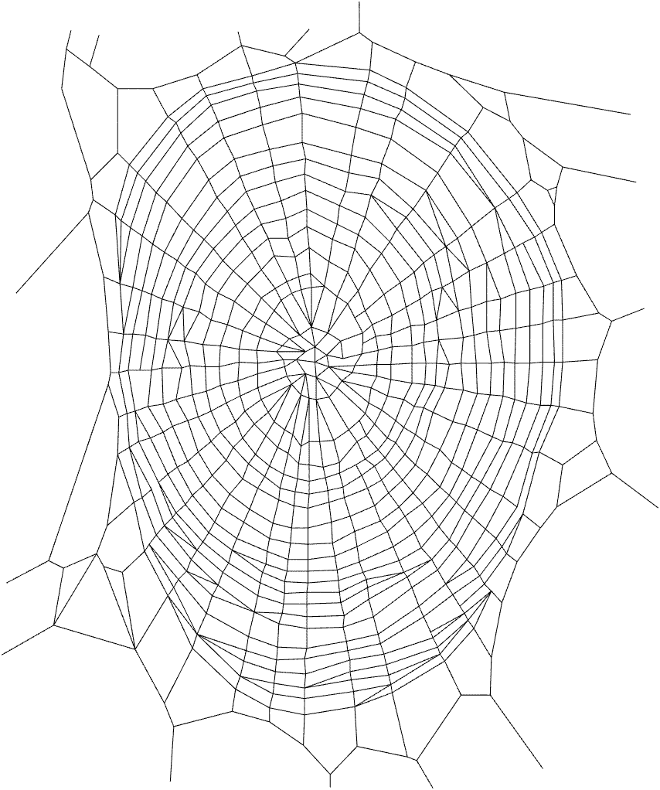

# Going Beyond Polynomial Eigenvalue Problems

The runnable companion is given in `src/demos/webs/tritare_web.m`, whose cells mirror the sections of this page.
Every string network on this page comes from J. P. Baker's [nlevp_webs](https://github.com/jpeterbaker/nlevp_webs) package and dissertation[^2], and the nlevp_webs is required to be on the MATLAB path to run all examples on this page.

## Motivation

In the _acoustic-wave-1D_ example the operator was a matrix polynomial in \( \lambda \), obtained by discretising a 1-D Helmholtz equation.
Discretisation captures low-frequency eigenmodes of the underlying *infinite-dimensional* problem well, but degrades for high-frequency modes.
This suggests working with the infinite-dimensional problem directly, trading polynomial nonlinearities for more general, transcendental ones.

## Plane Wave Solutions of the 1-D Wave Equation

Consider the 1-D wave equation

\[ u_{tt}(x,t) = c^2 u_{xx}(x,t), \quad x \in [0,1], \quad t > 0, \]

with boundary conditions

\[ u(0,t) = 0 \quad \text{and} \quad u(1,t) = u_x(1,t), \quad t > 0. \]

The ansatz \( u(x,t) = f(x) e^{i\lambda t} \), \( \lambda \in \mathbb{C} \), gives

\[ f_{xx}(x) = - \left( \frac{\lambda}{c} \right)^2 f(x). \]

Fixing \( c = 1 \), the function \( f(x) = \sin{( \lambda x )} \) satisfies the equation, and the right-hand boundary condition then requires

\[
\sin{ \lambda } = \lambda \cos{ \lambda }
\;\Leftrightarrow\;
T(\lambda) \coloneqq \tan{ \lambda } - \lambda = 0.
\]

\( T(\lambda) = 0 \) is a scalar transcendental eigenvalue problem.
Each root gives an exact eigenmode \( f(x) \) of the continuous problem.

??? note "Finding eigenvalues of \(T\)"
    ```matlab
    --8<-- "src/demos/webs/tritare_web.m:planewave"
    ```

Eigenvalues/Poles of \(T\) |  First 5 eigenmodes
:-------------------------:|:-------------------------:
|

??? note "Plotting code (pzT.png, f5ms.png)"
    Continues from the eigenvalue sweep above (`ew`).

    ```matlab
    --8<-- "src/demos/webs/tritare_web.m:planewave_plot"

    --8<-- "src/demos/webs/tritare_web.m:planewave_modes_plot"
    ```

A single string gives a scalar problem.
The same construction on a network of strings produces matrix-valued transcendental problems, some of whose eigenvalues are available in closed form.

## Networks of Strings

The [nlevp_webs](https://github.com/jpeterbaker/nlevp_webs) project[^2] assembles the planar modal vibrations of any network of elastic strings into an NLEVP.
On each string's interior the wave equation is solved exactly by sines and cosines, and the eigenvalue enters only through the boundary and junction conditions.
The construction converts a *linear, infinite-dimensional* problem into a *nonlinear, finite-dimensional* one[^3].

On string \( i \), component \( j \) of the modal displacement is a standing wave with sine coefficient \( A_{i,j} \) and cosine coefficient \( B_{i,j} \), where \( j = 1 \) is the longitudinal direction and \( j \ge 2 \) are transverse.
The coefficients are constrained by the fixed-frame condition at anchored ends, and by continuity and force balance at each free node.
The full construction goes into more detail[^2].
Note that eigenvalues with relative residual \( \lVert T(\lambda)\mathbf{v} \rVert_2 / \lVert T(\lambda) \rVert_F \geq 10^{-8} \) are marked with empty grey boxes in the figures below.

### The Three-String ("Tritare")

The *tritare*[^1] is the simplest interesting case: three strings meeting at a single free junction and anchored to the frame at their outer ends (\( n_e = 3 \)), vibrating in the plane (\( D = 2 \)).
`tritare.m` gives reference eigenvalues computed to 30 digits for two arm angles \( \theta \in \{\pi/2,\, 2\pi/3\} \).
\( \theta \) is the angle between two of the string arms, with the third string, lying opposite the arm bisector.
We consider \( \theta = \pi/2 \) first, with all eigenvalues purely imaginary (\( \lambda = i\omega \), no damping).
On a circle enclosing the ten lowest-frequency eigenvalues, CIM determines the enclosed count from the numerical rank of the Loewner data matrix.
It returns all 10 eigenvalues to machine precision (see `src/demos/webs/tritare_web.m`).

??? note "Code"
    ```matlab
    --8<-- "src/demos/webs/tritare_web.m:tritare"
    ```

The eigenvector \( \mathbf{v} \) holds the coefficients \( A_{i,j}, B_{i,j} \) of the mode shape, so it can be plotted directly as a vibrating Y:

Recovered vs 30-digit reference | Mode shape from the CIM eigenvector (\( \omega_3 \approx 1.55994 \))
:------------------------------:|:------------------------------:
 | 

The right panel reconstructs the third mode from its CIM eigenvector via the nlevp_webs `mode_curves` (grey: strings at rest; black: the displaced web).

??? note "Plotting code (tritare_eigs.png, tritare_mode.png)"
    Continues from the block above (`c`, `ew`, `V`, `ok`, `ew_ref`, and the geometry `TV, gamma, nodes, edges`).

    ```matlab
    --8<-- "src/demos/webs/tritare_web.m:tritare_plot"

    --8<-- "src/demos/webs/tritare_web.m:tritare_mode_plot"
    ```

#### Classifying Eigenvalue Types on the Symmetric Tritare

At \( \theta = 2\pi/3 \) the tritare becomes a symmetric three-armed star.
Symmetry makes the whole spectrum solvable in closed form, which gives an exact reference for what CIMTOLL reads off of a contour.
The assembled operator \( T(\lambda) \) is \( 2Dn_e \times 2Dn_e = 12\times12 \), one column per coefficient \( A_{i,j}, B_{i,j} \)[^2].
Every string is anchored to the frame at one end, so \( B_{i,j} = 0 \) for all \( i, j \);
what remains is an order-6 problem in the sine coefficients.
It is written for real \( \omega \), with \( \lambda = i\omega \), and denoted \( \widehat T \) to separate it from the \( 12\times12 \) operator:

\[
\widehat T(\omega)\begin{pmatrix}A_{1,1}\\A_{1,2}\\A_{2,1}\\A_{2,2}\\A_{3,1}\\A_{3,2}\end{pmatrix}=\mathbf{0},\qquad
\widehat T(\omega)=\begin{pmatrix}
\sin\sqrt2\omega & 0 & \tfrac12\sin\sqrt2\omega & -\tfrac{\sqrt3}{2}\sin2\omega & 0 & 0\\
0 & \sin2\omega & \tfrac{\sqrt3}{2}\sin\sqrt2\omega & \tfrac12\sin2\omega & 0 & 0\\
\sin\sqrt2\omega & 0 & 0 & 0 & \tfrac12\sin\sqrt2\omega & -\tfrac{\sqrt3}{2}\sin2\omega\\
0 & \sin2\omega & 0 & 0 & -\tfrac{\sqrt3}{2}\sin\sqrt2\omega & -\tfrac12\sin2\omega\\
\sqrt2\cos\sqrt2\omega & 0 & -\tfrac1{\sqrt2}\cos\sqrt2\omega & \tfrac{\sqrt3}{2}\cos2\omega & -\tfrac1{\sqrt2}\cos\sqrt2\omega & \tfrac{\sqrt3}{2}\cos2\omega\\
0 & \cos2\omega & -\tfrac{\sqrt3}{\sqrt2}\cos\sqrt2\omega & -\tfrac12\cos2\omega & \tfrac{\sqrt3}{\sqrt2}\cos\sqrt2\omega & \tfrac12\cos2\omega
\end{pmatrix}.
\]

The top four rows are the continuity conditions at the junction, and the bottom two are the force-balance condition.
The longitudinal and transverse phases across a string are \( \sqrt2\,\omega \) and \( 2\omega \).
`general_web` assembles the same conditions up to row scaling and the orientation of each string's local axes, so the eigenvalues agree.

The eigenvalues fall into three types[^3], which follow from examining how the four continuity rows can vanish.

<div markdown style="text-align: center">

Type | Condition | Frequencies
:---:|:---------:|:-----------:
1 (transverse) | \( \sin 2\omega = 0 \) | \( \omega = m\pi/2 \)
2 (longitudinal) | \( \sin\sqrt2\,\omega = 0 \) | \( \omega = m\pi/\sqrt2 \)
3 (junction-moving) | \( \tan\sqrt2\,\omega + \sqrt2\tan 2\omega = 0 \) | transcendental

</div>

The figure below shows one mode shape per type: the junction fixed with arms bowing (type 1), the junction fixed with longitudinal compression visible in the dot spacing (type 2), and the whole web swinging about a displaced junction (type 3).



??? note "Plotting code (tritare_types.png)"
    Recovers one trusted representative of each family and reconstructs its mode shape with `mode_curves`.

    ```matlab
    --8<-- "src/demos/webs/tritare_web.m:types_plot"
    ```

For type 1 eigenvalues the tritare rings as three individual strings clamped at each end (the endpoints and the shared junction).
The longitudinal coefficients \( A_{i,1} \) vanish and the eigenvector is a multiple of \( [0,1,0,1,0,-1]^\top \).
Type 2 forces \( A_{i,2} = 0 \), and the eigenvector is a multiple of \( [1,0,1,0,1,0]^\top \).
For type 3 the junction moves, and the eigenspace is two-dimensional:

\[
\operatorname{span}\left\{
\begin{pmatrix} 0 \\ 2\sin\sqrt2\omega \\ -\sqrt3\,\sin2\omega \\ -\sin\sqrt2\omega \\ \sqrt3\,\sin2\omega \\ \sin\sqrt2\omega \end{pmatrix},\;
\begin{pmatrix} 2\sin2\omega \\ 0 \\ -\sin2\omega \\ \sqrt3\,\sin\sqrt2\omega \\ -\sin2\omega \\ \sqrt3\,\sin\sqrt2\omega \end{pmatrix}
\right\}.
\]

Of the 24 reference eigenvalues, 5 are of type 1, 3 of type 2, and 16 of type 3 (eight distinct values, each a derogatory double).

#### Realizing Eigenpairs

The derogatory doubles, linearly dependent eigenvectors of the type-1 and type-2 families, and closed-form reference make the symmetric three-string a great validation problem for CIM solvers[^3].
The contour of the \( \theta = \pi/2 \) example, \( \texttt{Circle(2i, 1.5)} \), is reused on the \( \theta = 2\pi/3 \) operator.
It encloses nine eigenvalues counted with multiplicity, six of them the three type-3 doubles.
The count is one lower than at \( \theta = \pi/2 \) because one eigenvalue leaves the circle at \( \theta \approx 1.72 \).



The left panel colours each recovered eigenvalue by family, while the right panel shows the principal subspace angle between each recovered eigenvector and the analytic eigenspace.

??? note "Code (eigenvalue and eigenvector accuracy)"
    Continues from the \( \theta = \pi/2 \) block above, whose CIM (`op`, `c`, `cim`) is reused.

    ```matlab
    --8<-- "src/demos/webs/tritare_web.m:pairs"
    ```

??? note "Plotting code (tritare_recovery.png)"
    Continues from the block above (`c`, `ew`, `ew_ref`, `ang`, `ok`); colours each eigenvalue by its family.

    ```matlab
    --8<-- "src/demos/webs/tritare_web.m:pairs_plot"
    ```

#### \( \theta \) as a parameter

`tritare(θ)` assembles \( T(\lambda;\theta) \) for any \( \theta \in (0,\pi) \), so the \( \theta = \pi/2 \) and \( \theta = 2\pi/3 \) problems above are two slices of a single parametric NLEVP[^2].
The figure traces the eigenvalues within the same circle as the previous section as \( \theta \) sweeps \( [\pi/6, 5\pi/6] \):



At \( \theta = 2\pi/3 \) the type-3 frequencies are doubles (circled), where eigenvalues cross.
Changing the angle away from \( 2 \pi / 3 \) breaks the symmetry and splits each double into two simple eigenvalues; type-1 and type-2 frequencies stay simple.

??? note "Code (eigenvalue trajectories vs \( \theta \))"
    Continues from the blocks above, reusing the \( \theta = \pi/2 \) CIM at every arm angle.

    ```matlab
    --8<-- "src/demos/webs/tritare_web.m:loci"
    ```

??? note "Plotting code (tritare_loci.png)"
    Continues from the loop above (`c`, `th`, `loci`, `ok`); shades the enclosed band and marks the two example slices.

    ```matlab
    --8<-- "src/demos/webs/tritare_web.m:loci_plot"
    ```

### The \(n\)-string and Loewner Probing

The eigenvalue types generalize as \(n\) is varied.
`general_web` builds the \( n \)-armed star directly, with unit tensions balanced at the junction for any \( n \).
Each of the \( n \) arms carries an independent transverse clamped-string mode at \( \omega = \pi/2 \), and force balance at the junction removes two of the \( n \) arm amplitudes.
Thus, the type-1 eigenvalue at \( i\pi/2 \) has multiplicity \( n - 2 \)[^3].

??? note "Code"
    ```matlab
    --8<-- "src/demos/webs/tritare_web.m:nstring"
    ```



??? note "Plotting code (nstar_mult.png)"
    Continues from the loop above (`svals`).

    ```matlab
    --8<-- "src/demos/webs/tritare_web.m:nstring_plot"
    ```

!!! warning "The number of probing directions bounds the recoverable multiplicity"

    The one-sided samples \( \mathbf{L}^*\mathbf{T}(z)^{-1} \) and \( \mathbf{T}(z)^{-1}\mathbf{R} \) can expose an eigenspace of dimension at most \( \min(\ell, r) \).
    Rerunning the \( n = 6 \) star with \( \ell = r = 2 \) undercounts the multiplicity-4 eigenvalue:

    ```matlab
    --8<-- "src/demos/webs/tritare_web.m:probing"
    ```

    The realized eigenvalue undercounts the true multiplicity, and the Loewner singular values do not indicate this.
    When multiple eigenvalues are possible, \( \ell \) and \( r \) should be at least as large as the maximum multiplicity to be resolved.
    §4.2.2 of [^2] bounds the number of moments needed for a full-rank realization through the Cayley–Hamilton theorem and the degree of the minimal polynomial.
    Its Theorem 4.2 caps the rank gained per moment within a left-invariant subspace at the rank of the probing directions restricted to it.

## A Large-Scale Orb-Weaver's Web

The runnable companion is at `src/demos/webs/orb_web.m`.

nlevp_webs' `spider2` is a traced orb-weaver web with 633 nodes and 1241 string edges, whose planar modal vibrations give a \( 4964 \times 4964 \) trigonometric NEP.
`general_web` assembles \( T(\lambda) \) densely, but the operator is sparse (0.16 % dense).
CIMTOOL can take advantage of this by using sparse solves at each quadrature point, saving a substantial amount of memory (a dense \( n \times n \times K \) sample array at \( K = 48 \) would be \(\approx\)19 GB).

??? note "Code"
    ```matlab
    --8<-- "src/demos/webs/orb_web.m:orb"
    ```

The 24 reference eigenvalues are purely imaginary, and the two lowest sit well apart from the rest.
Note that the figure plots \( \operatorname{Im} \lambda \) horizontally.



??? note "Plotting code (orb_spectrum.png)"
    Continues from the block above (`c`, `ew`, `ok`, `ew_ref`).

    ```matlab
    --8<-- "src/demos/webs/orb_web.m:orb_spectrum_plot"
    ```

The CIM eigenvector reconstructs the fundamental mode shape of the whole web:



??? note "Plotting code (orb_mode.png)"
    Continues from the block above (`ew`, `V`, and the geometry `TV, gam, nodes, edges`).

    ```matlab
    --8<-- "src/demos/webs/orb_web.m:orb_mode_plot"
    ```

[^1]: S. Gaudet, C. Gauthier, S. Léger, and C. Walker, "The vibrations of a
real 3-string: the timbre of the tritare," *Journal of Sound and Vibration*,
vol. 281, no. 1--2, pp. 219--234, 2005.

[^2]: J. P. Baker, "Vibrations of mechanical structures: source localization
and nonlinear eigenvalue problems for mode calculation," Ph.D. dissertation,
Virginia Tech, Blacksburg, VA, 2023.

[^3]: M. Embree, M. Brennan, S. Gugercin, J. Baker, D. Folescu, and J. Green,
"Contour Integral Eigensolvers, Rational Interpolation, and System
Identification," presented at *Numerical Analysis in the 21st Century*,
Oxford, August 2023.
